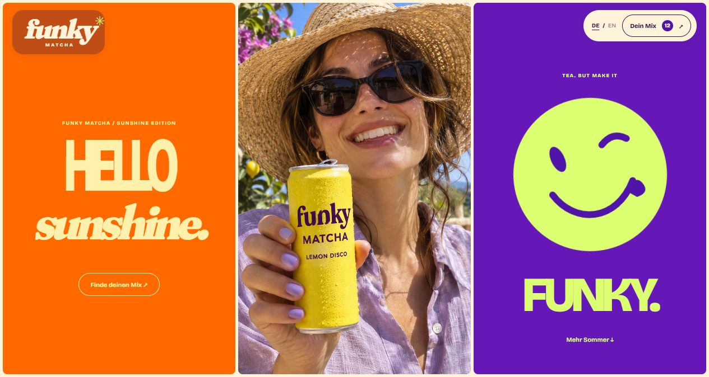

# Funky Matcha

A bilingual beverage website with a summer campaign, a six-flavour photo wall, and a build-your-own matcha pack. Designed and developed by [BAUVERIS](https://bauveris.de/en/).



## Features

- Animated colour and splash reveal with skip and reduced-motion support
- Six flavour photographs, enlarged image views, and direct flavour selection
- Looping lifestyle player with pause and expanded view
- Six- or twelve-can mix builder with quantity limits and live totals
- Collection review, delivery details, form validation, and confirmation
- German and English, responsive layouts, keyboard controls, and local preference storage

## Run locally

Use Node.js and run:

```sh
node server.cjs
```

Open `http://127.0.0.1:4390/`. On Windows you can also run `START.cmd`. The local server serves the site and media. All browser features use HTML, CSS and vanilla JavaScript.

```sh
node --test site.test.cjs
```

The shopping flow runs locally in the browser. The confirmation reflects the selected mix and delivery details. A commercial setup can connect payment, order processing, fulfilment, and email according to the agreed scope.

## Media credits

The product and lifestyle images were created for this project. Fraunces and Bricolage Grotesque are distributed under the SIL Open Font License. Their license files are included in this repository.

The lifestyle film is [Woman Dancing with a Shining Background](https://www.pexels.com/video/woman-dancing-with-a-shining-background-6835385/) by Mikhail Nilov, used under the [Pexels License](https://www.pexels.com/license/). The dancer appears as stock footage within the site.
